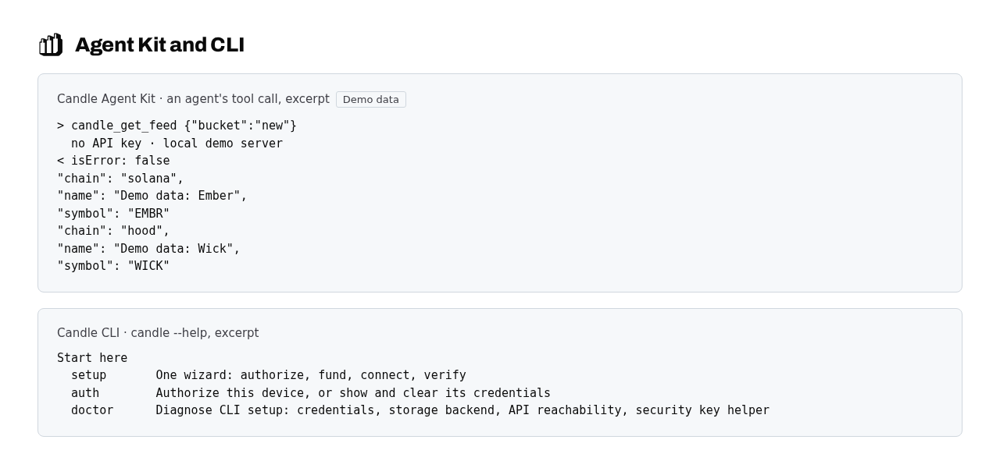

<picture>
  <source media="(prefers-color-scheme: dark)" srcset="assets/candle-mark-dark.svg">
  
</picture>

## Put your agent to work onchain.

Connect an agent, work from the command line, or bring your agents and markets into one terminal
workspace.

Use scoped Candle API keys without putting wallet private keys in the model's context.
[How control works](#how-control-works)

Each product works on its own. Pick the one that fits how you work today:

| Product | What it is for | Start |
| --- | --- | --- |
| [**Candle Agent Kit**](https://github.com/candledottv/agent-kit) | Connect an agent or app you already have | [Try a market read](https://github.com/candledottv/agent-kit#try-a-market-read-no-account-required) |
| [**Candle CLI**](https://github.com/candledottv/cli) | Work with wallets and Candle from commands and scripts | [Install the CLI](https://github.com/candledottv/cli#install) |
| **Candle TUI** | Watch and steer your agents in one terminal | In development · [See preview](https://docs.candle.tv/developers/cli#commands) |

<picture>
  <source media="(prefers-color-scheme: dark)" srcset="assets/family-dark.png">
  
</picture>

*Agent Kit and CLI. Top: a keyless `candle_get_feed` call answered by a local demo server (demo
data, not market facts). Bottom: the start of `candle --help`.*

## What you can do

- **Inspect markets.** Ask an agent for new tokens on Solana and Hood and get a readable answer
  with no account. [Read a market](https://github.com/candledottv/agent-kit#workflow-examples)
- **Operate wallets.** Hold keys in a local encrypted vault, or give an agent its own wallet in a
  hardware enclave (TEE), from one command line. [Wallets and custody](https://github.com/candledottv/cli#wallets-and-custody)
- **Supervise agent proposals.** Let agents propose trades through the local Candle core while you
  approve each live money action. [Core connection](https://docs.candle.tv/developers/cli#commands)

## How control works

A Candle API key authorizes what it has been granted, and nothing more. Connect directly through
MCP or the SDK, and authorized writes run without a local prompt. Connect through the local Candle
core, and agents can only propose a live money action until you approve it; transfers stay with
you.

Keys in your local vault stay on your machine. Promoting a key into a hardware enclave (TEE) lets
an agent trade with it without unlocking your vault, and funding, transfers and sweeping remain
separate steps you choose. Give each key only the access and limits its job needs, and revoke it
if it leaks. Limits and approvals do not prevent trading losses.

[Agent access and API keys](https://docs.candle.tv/developers/agent-access) ·
[CLI custody](https://docs.candle.tv/developers/cli-custody)

## Docs and support

- Documentation: [docs.candle.tv](https://docs.candle.tv)
- Verify a release: [docs.candle.tv/developers/verify-a-candle-release](https://docs.candle.tv/developers/verify-a-candle-release)
- Report a vulnerability: [Vulnerability disclosure policy](https://docs.candle.tv/rights-and-reporting/vulnerability-disclosure)
- Bugs, setup questions and requests: open an issue in that product's repository. Never paste a
  key, a recovery phrase or a token.
